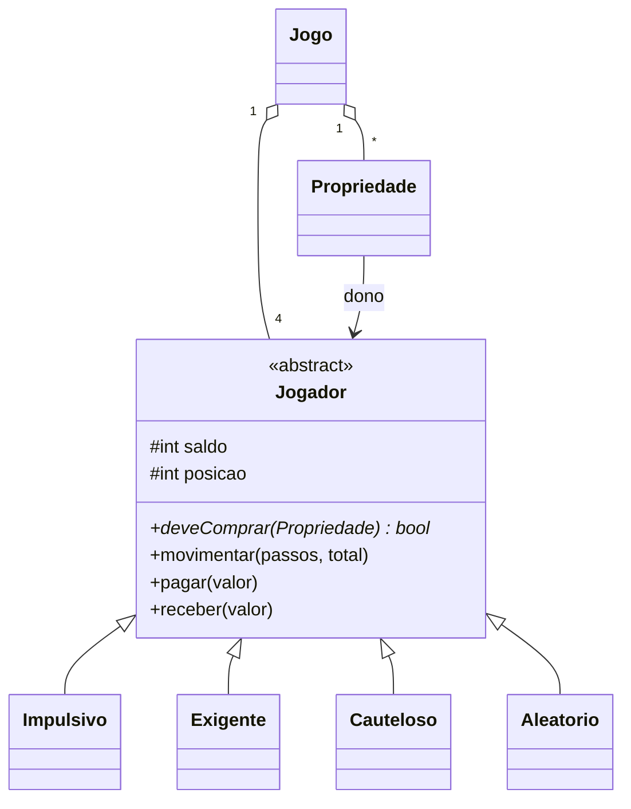

# Bankrupt · simulação em Java

 

Simulador de um jogo de tabuleiro no estilo Banco Imobiliário em que **quatro jogadores com estratégias diferentes** disputam 300 partidas, para descobrir qual comportamento vence mais.

Atividade da disciplina de Programação Orientada a Objetos (ADS, FATEC Praia Grande).

## As estratégias

| Jogador | Compra a propriedade quando… |
|---|---|
| **Impulsivo** | tem saldo para pagar. Compra tudo. |
| **Exigente** | tem saldo **e** o aluguel da propriedade passa de 50 |
| **Cauteloso** | depois de comprar ainda sobram pelo menos 80 de reserva |
| **Aleatório** | tem saldo e uma moeda cai cara (50%) |

Regras: todos começam com 300, ganham 100 a cada volta no tabuleiro, pagam aluguel ao cair em propriedade de outro jogador e saem do jogo com saldo negativo. As propriedades de quem quebra voltam para o banco. Uma partida termina quando sobra um jogador ou atinge 1000 rodadas.

## Como o código está modelado



O ponto central é o **polimorfismo**. O `Jogo` não sabe qual estratégia cada jogador usa: ele só pergunta `deveComprar(prop)`. Cada subclasse responde do seu jeito. Para criar uma estratégia nova, basta uma classe nova com um método, sem mexer no `Jogo`. É o padrão Strategy usando herança.

O diagrama de classes entregue na disciplina está em [`DiagramaClasses.png`](DiagramaClasses.png).

## Exemplo de saída

```
Partidas que terminaram por timeout: 181
Turnos médios por partida: 660.28
Vitórias de Impulsivo: 38.67%
Vitórias de Cauteloso: 30.33%
Vitórias de Exigente: 18.00%
Vitórias de Aleatório: 13.00%
Comportamento que mais vence: Impulsivo
```

Os números mudam a cada execução, porque dados e ordem dos jogadores são sorteados. Mesmo assim, o Impulsivo costuma liderar: comprar cedo gera aluguel por mais tempo.

## O que aprendi

- Classe abstrata e método abstrato para obrigar cada estratégia a decidir a compra
- Polimorfismo na prática: o mesmo código chamando comportamentos diferentes
- Separar o motor do jogo (`Jogo`) das regras de decisão (jogadores)
- Rodar muitas simulações e tirar estatística do resultado, em vez de confiar em uma partida só

## Rodando

```bash
git clone https://github.com/lucas-gonzales-dev/poo-bankrupt-java.git
cd poo-bankrupt-java
javac -d bin src/*.java
java -cp bin Main        # rode da raiz: o Main lê o gameConfig.txt
```

---

Feito por **Lucas Leite Gonzales** · [LinkedIn](https://www.linkedin.com/in/lucas-leite-gonzales-dev/)
